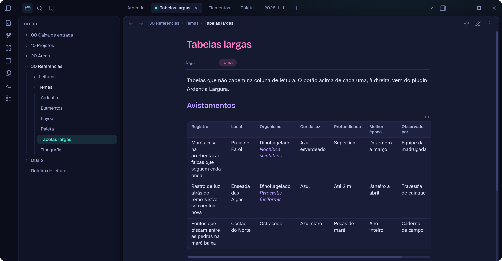
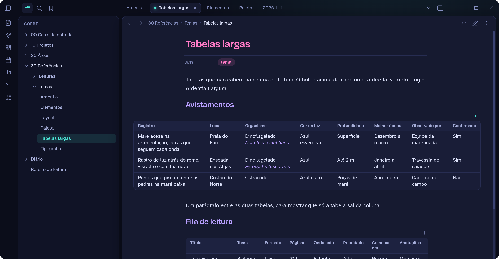

# Ardentia Largura

<b>English</b> · <a href="README.pt-BR.md">Português</a>

*Largura* is Portuguese for width. This Obsidian plugin adds two buttons that a theme cannot: one stretches the whole note to the full width of the pane, the other stretches a single table and leaves the text around it in the reading column.

It was made as a companion to the [Ardentia](https://github.com/jotafurtado/ardentia) theme and works with any theme.

| Table in the reading column | Same table, expanded |
| --- | --- |
|  |  |

## What it does

- **Note button.** In the note header, next to the reading and editing toggle. It expands the reading column to the width of the pane and brings it back. The command "Toggle note width" does the same and accepts a hotkey.
- **Table button.** Above each table, at the right. It expands only that table to the width of the pane, so a table with many columns stops scrolling sideways while the paragraphs keep a comfortable line length.
- **It remembers.** The state is saved per note and per table, and applies to both reading view and Live Preview. With a synced vault it follows you across devices.

## Install

**From Obsidian**, once the plugin is listed in the community directory: Settings, Community plugins, Browse, then search for Ardentia Largura.

**By hand**, which works today:

1. Download `main.js`, `manifest.json` and `styles.css` from the [latest release](https://github.com/jotafurtado/ardentia-width/releases/latest).
2. Put the three files in `<your vault>/.obsidian/plugins/ardentia-width/`.
3. Restart Obsidian and enable Ardentia Largura in Settings, Community plugins.

Requires Obsidian 1.8.7 or later.

## Good to know

- The note button only has an effect when "Readable line length" is on in Settings, Editor. With it off, the note already uses the whole pane.
- Only top-level tables get a button. A table inside a callout or a list item does not.
- A table is identified by its position in the note (first, second, third). Adding or removing a table above an expanded one shifts the saved state to its neighbor.
- State is stored in the plugin's `data.json`, keyed by note path. Renaming or deleting a note updates it.
- The button labels follow Obsidian's language: Portuguese when Obsidian is in Portuguese, English otherwise.
- Not yet tested on mobile.

## Privacy

The plugin makes no network requests, collects no telemetry and reads nothing outside the vault.

## Development

```bash
npm install
npm run dev      # rebuilds main.js on every change
npm run build    # type-checks and builds for release
npm run lint     # the rules used by the community directory review
```

To try it in a vault, link or copy the folder to `<vault>/.obsidian/plugins/ardentia-width/`.

A tag in the form `x.y.z` that matches `version` in `manifest.json` triggers the release workflow, which builds the plugin and attaches `main.js`, `manifest.json` and `styles.css` to a GitHub release.

## License

[MIT](LICENSE)
