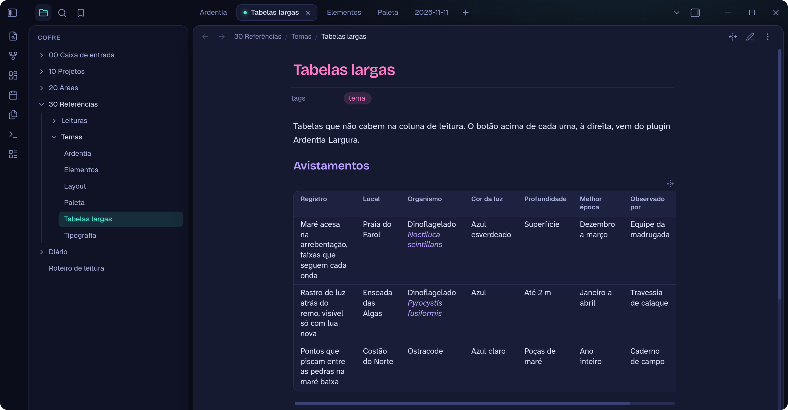
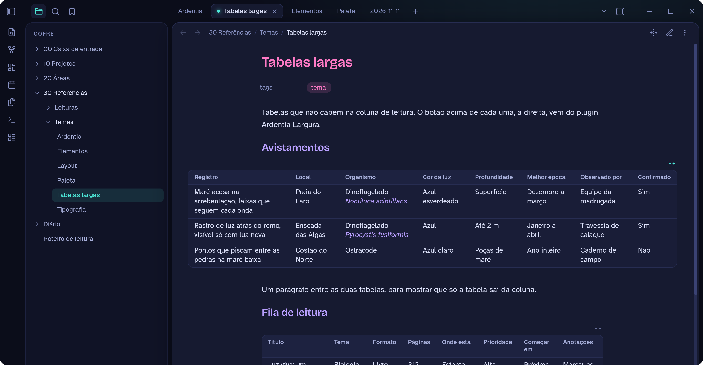

# Ardentia Largura

<a href="README.md">English</a> · <b>Português</b>

Plugin para o Obsidian que cria dois botões que um tema não consegue criar: um estica a nota inteira até a largura do painel, o outro estica uma única tabela e deixa o texto em volta na coluna de leitura.

Nasceu como companheiro do tema [Ardentia](https://github.com/jotafurtado/ardentia) e funciona com qualquer tema.

| Tabela na coluna de leitura | A mesma tabela, expandida |
| --- | --- |
|  |  |

## O que faz

- **Botão da nota.** No cabeçalho da nota, ao lado do botão que alterna leitura e edição. Expande a coluna de leitura até a largura do painel e volta. O comando "Alternar Largura da Nota" faz o mesmo e aceita atalho.
- **Botão da tabela.** Acima de cada tabela, à direita. Expande só aquela tabela até a largura do painel: a tabela de muitas colunas para de rolar para o lado e os parágrafos continuam com linha confortável.
- **Ele lembra.** O estado fica salvo por nota e por tabela, e vale no modo de leitura e no Live Preview. Em cofre sincronizado, acompanha você entre as máquinas.

## Instalação

**Pelo Obsidian**, quando o plugin estiver listado no diretório da comunidade: Configurações, Plugins da comunidade, Explorar, e busque por Ardentia Largura.

**À mão**, que funciona hoje:

1. Baixe `main.js`, `manifest.json` e `styles.css` do [release mais recente](https://github.com/jotafurtado/ardentia-width/releases/latest).
2. Coloque os três arquivos em `<seu cofre>/.obsidian/plugins/ardentia-width/`.
3. Reinicie o Obsidian e ative Ardentia Largura em Configurações, Plugins da comunidade.

Requer o Obsidian 1.8.7 ou mais novo.

## Bom saber

- O botão da nota só tem efeito com "Comprimento de linha legível" ligado em Configurações, Editor. Com ele desligado, a nota já ocupa o painel todo.
- Só tabelas de primeiro nível recebem botão. Tabela dentro de callout ou de item de lista não recebe.
- A tabela é identificada pela posição na nota (primeira, segunda, terceira). Inserir ou remover uma tabela acima de uma expandida desloca o estado salvo para a vizinha.
- O estado fica no `data.json` do plugin, por caminho de nota. Renomear ou apagar a nota atualiza o registro.
- Os rótulos dos botões seguem o idioma do Obsidian: português quando ele está em português, inglês nos demais.
- Ainda não foi testado no celular.

## Privacidade

O plugin não faz requisição de rede, não coleta telemetria e não lê nada fora do cofre.

## Desenvolvimento

```bash
npm install
npm run dev      # gera o main.js a cada mudança
npm run build    # checa os tipos e gera o build de release
npm run lint     # as regras usadas na revisão do diretório da comunidade
```

Para testar em um cofre, crie um link ou copie a pasta para `<cofre>/.obsidian/plugins/ardentia-width/`.

Uma tag no formato `x.y.z`, igual à `version` do `manifest.json`, dispara o workflow de release, que compila o plugin e anexa `main.js`, `manifest.json` e `styles.css` a um release do GitHub.

## Licença

[MIT](LICENSE)
